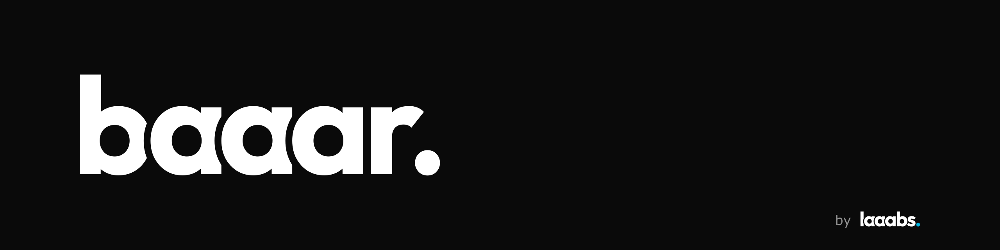
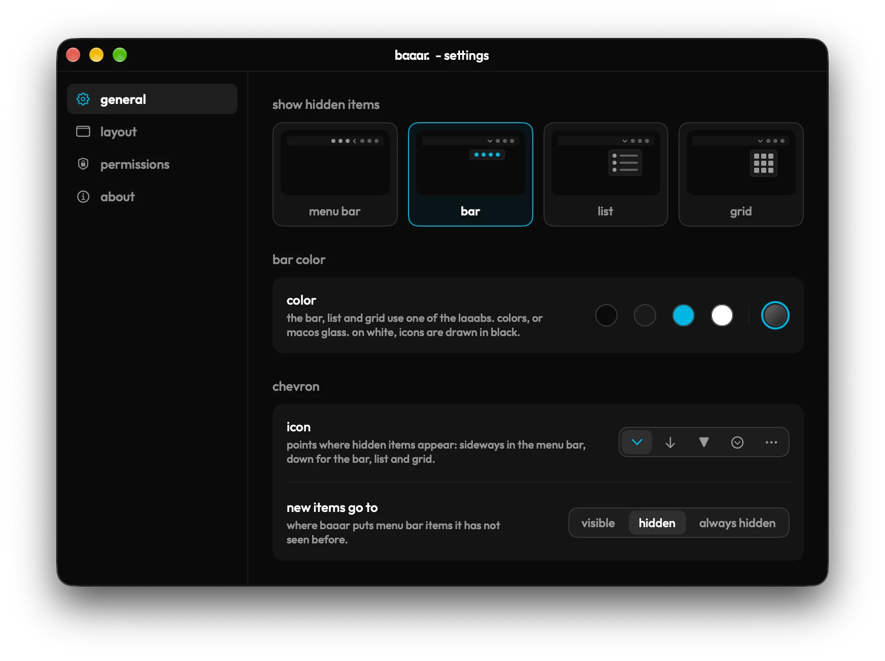
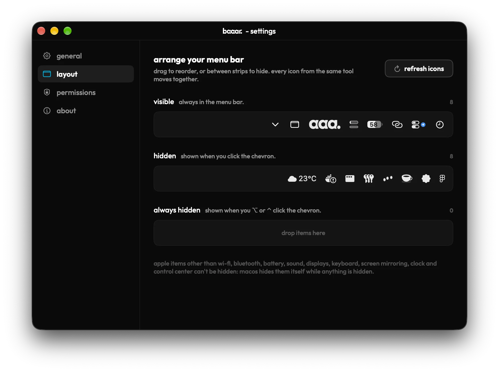
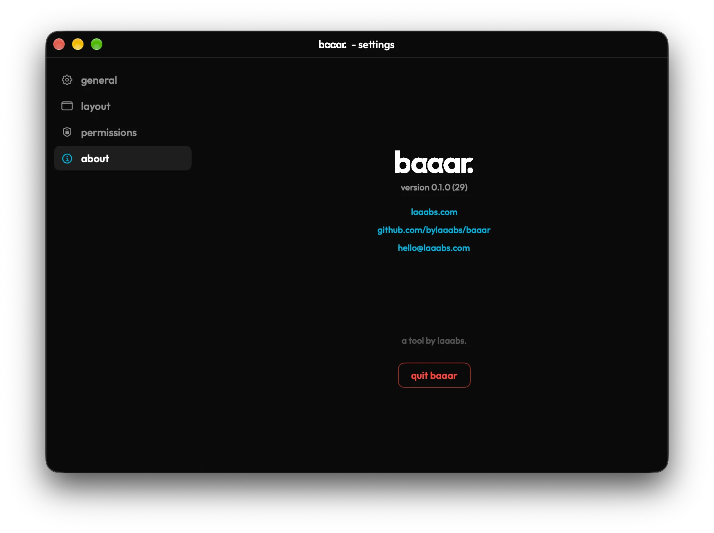

<p align="center">
  <picture>
    <source media="(prefers-color-scheme: dark)" srcset="docs/images/banner-dark.png">
    <source media="(prefers-color-scheme: light)" srcset="docs/images/banner-light.png">
    
  </picture>
</p>

<p align="center">
  a menu bar manager for macOS 27: hide the items you do not need, and reach them from the menu bar, a bar, a list or a grid.
</p>

<p align="center">
  <a href="https://laaabs.com/tools/baaar">laaabs.com/tools/baaar</a> - <a href="#install">install</a> - <a href="#build-from-source">build from source</a> - <a href="docs/PRIVACY.md">privacy</a>
</p>

<p align="center">
  
</p>
<p align="center">
  
  
</p>

## why

macOS 27 draws the whole menu bar into one window, which broke every manager built on per-item windows, and a crowded bar still hides items behind the notch. baaar hides the items you do not need through MenuBarAgent's own visibility restriction, so their space comes back, and shows them again from the menu bar or from a small bar under it. it runs entirely on the Mac: no network, no telemetry.

alpha. macOS 27 only. baaar depends on a private macOS framework: a macOS update can change it, and when it does, baaar keeps running, stops hiding, and says so in its settings.

## install

- **homebrew**: `brew install --cask bylaaabs/tap/baaar`
- **download**: the dmg from the [latest release](https://github.com/bylaaabs/baaar/releases/latest), open it and drag baaar to Applications.

the release is signed with a Developer ID and notarized. there are no automatic updates yet: `brew upgrade` or a new dmg.

## what it does

baaar adds two items to the menu bar: the **chevron**, which hides and shows, and the **baaar icon**, which opens its menu and settings. the menu bar is split in three sections: **visible**, **hidden** and **always hidden**.

- **drag bundles between sections** in the layout pane of settings. everything one bundle puts in the menu bar moves together.
- **click the chevron** to show hidden items. **⌥ or ⌃ click** it to show only the always hidden ones. **right-click** it for its menu.
- **pick how hidden items appear**: in the menu bar itself, a horizontal bar, a vertical list or a grid.
- **click an item** in the bar, list or grid: baaar shows it in the menu bar for a moment, opens its menu under it, and hides it again when the menu closes.
- **quitting or crashing brings every item back**: the restriction dies with baaar.

### how it works

| need | mechanism |
| --- | --- |
| hide | MenuBarAgent's visibility restriction: `MBAssessmentModeAssertion` in the private `MenuBarClientCore` framework, the allow-list assessment mode uses. baaar allows every running bundle except the hidden ones, plus the system items that stay visible. MenuBarAgent lays out only those, and the rest leave the bar and free their space. |
| list items | each process's `AXExtrasMenuBar`, read through Accessibility in parallel. hidden items are remembered from the last scan that saw them. |
| picture items | a few items at a time are shown alone in the menu bar, with baaar's own items blanked. a ScreenCaptureKit still of the transparent `Menubar` window is cropped to each item and cached in `~/Library/Caches/com.laaabs.baaar`. the cursor never moves. |
| open an item | the item's bundle is allowed for a moment, then `AXPress` opens it where it is drawn. baaar watches for its menu or popover to close, then hides it again. |
| Notification Center | MenuBarAgent will not open it while a restriction is active, so a click on the clock lifts the restriction until Notification Center closes. |

### known limitations

- **bundles hide whole.** every item one bundle puts in the menu bar shares a section.
- **Apple's other modules disappear while anything is hidden.** only the nine system items (battery, Bluetooth, clock, displays, keyboard brightness, sound, Wi-Fi, screen mirroring, Control Center) can stay visible under the restriction.
- **a menu bar that is not on screen cannot be pictured.** in full screen or with the menu bar set to hide, baaar waits for it.

## privacy and permissions

baaar collects nothing and makes no network calls. settings, pictures of items and logs stay on the Mac. the full list of what it keeps and where: [docs/PRIVACY.md](docs/PRIVACY.md).

- **Accessibility, required.** baaar lists, opens and pictures items through it.
- **Screen Recording, optional.** only to picture items: stills of the menu bar, cropped to each item. without it the bar shows each owner's icon. never video, never another window.
- **the menu bar layout file, optional.** to reorder items from the layout pane, you pick macOS's own layout file once in an open panel.

every permission, when it is asked for and what happens without it: [docs/PERMISSIONS.md](docs/PERMISSIONS.md).

## requirements

- macOS 27.
- to build: Xcode 26 or later and [XcodeGen](https://github.com/yonaskolb/XcodeGen).

## build from source

```sh
brew install xcodegen
git clone https://github.com/bylaaabs/baaar.git
cd baaar
scripts/build.sh                                   # debug build
CONFIGURATION=Release scripts/build.sh --install   # copy to /Applications and launch
```

the look comes from the studio's swift kit, [bylaaabs/ui-swift](https://github.com/bylaaabs/ui-swift), a Swift package that is still private: until it is public, building needs read access to it. the `brand` and `map` submodules are not needed to build.

set `CODE_SIGN_IDENTITY` if you have more than one "Apple Development" certificate. privacy grants follow the signing identity, and System Settings lists them only for tools in a regular location such as `/Applications`, which is why `--install` copies baaar there. how the code is laid out: [docs/ARCHITECTURE.md](docs/ARCHITECTURE.md).

## contributing

issues and pull requests are welcome. start with [CONTRIBUTING.md](CONTRIBUTING.md) and [AGENTS.md](AGENTS.md), the naming, voice and architecture rules for people and agents. the [code of conduct](CODE_OF_CONDUCT.md) and the [security policy](SECURITY.md) follow the studio defaults in [bylaaabs/.github](https://github.com/bylaaabs/.github). bugs and ideas go in [issues](https://github.com/bylaaabs/baaar/issues); what changed is in the [changelog](CHANGELOG.md).

## license

[Apache License 2.0](LICENSE). the baaar and laaabs. names and marks are not part of the license.

<p align="center">a tool by <a href="https://laaabs.com/tools/baaar">laaabs.</a></p>
